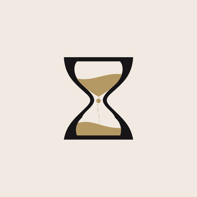
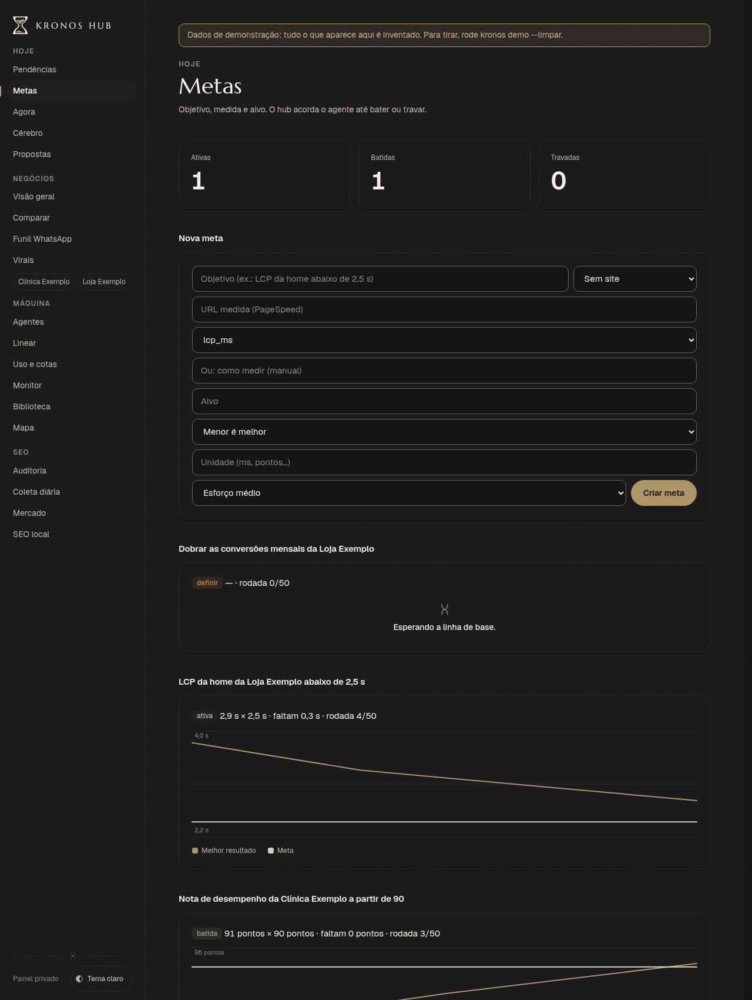
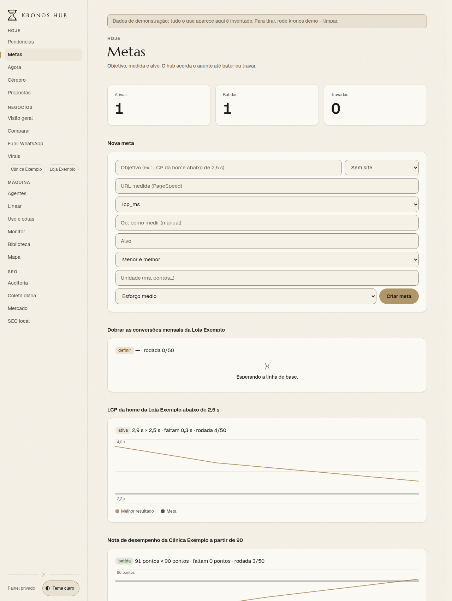
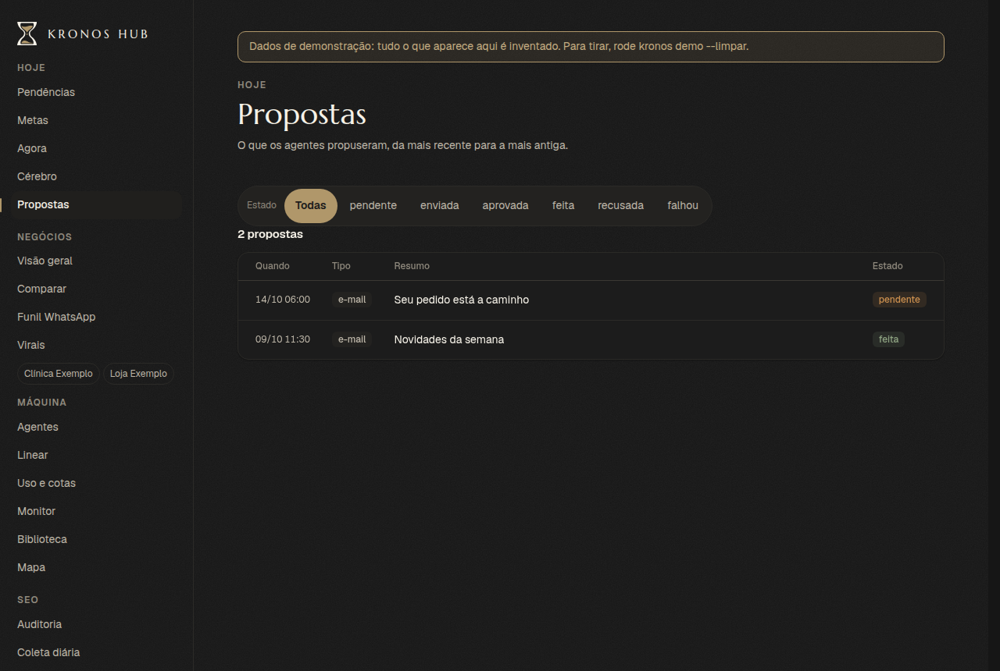
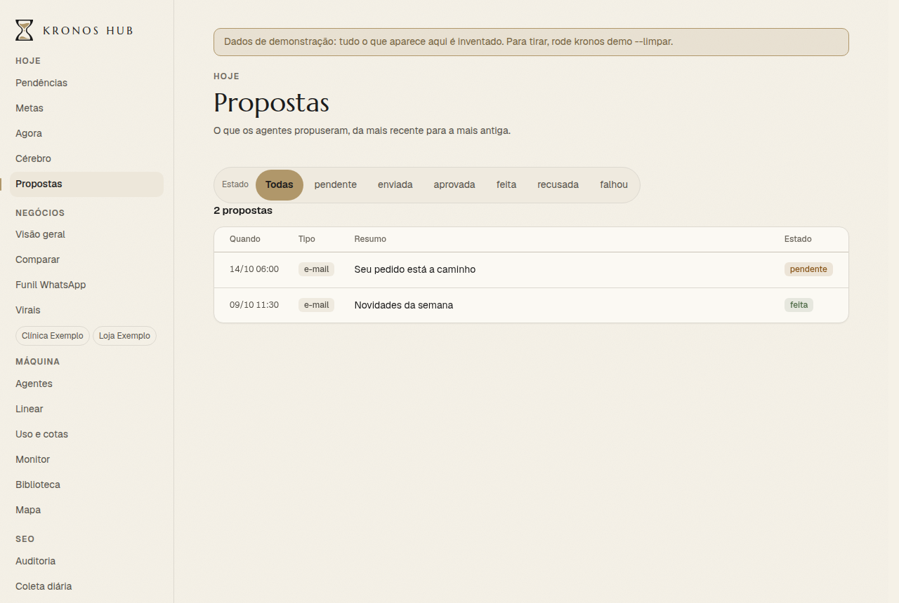

<p align="center"></p>

<h1 align="center">Krohnos</h1>

<p align="center"><b>O harness que transforma agentes de código com IA em um time que você comanda pelo celular.</b></p>

<p align="center"><a href="README.md">Read in English</a> · <a href="docs/harness.md">O harness</a> · <a href="docs/ARQUITETURA.md">Arquitetura</a> · <a href="ROADMAP.md">Roadmap</a> · Licença: AGPL-3.0</p>

---

**Uma pessoa. Seis produtos no ar. Quatro contas do Claude Code e o Codex revisando.
1.309 pull requests mergeados em 7 dias (7 a 14/10/2026), comandados pelo celular.**

O Krohnos é o sistema por trás desses números. Não é um modelo nem um agente novo: é o *harness* em volta dos
agentes. A fila, as regras, os portões e a memória que fazem vários agentes entregarem trabalho confiável.

## O que faz

```
Você (WhatsApp / painel; Linear opcional)
   │  pedido em linguagem comum
   ▼
Orquestrador ──► contrato da tarefa (resultado, escopo, o que não pode mudar, prova de pronto)
   │
   ▼
Fila (própria; Linear opcional) ──► 4 contas de agente, uma worktree git cada (faixas construtor / operador)
   │
   ▼
Portões: testes (CI local) ─► revisão por segundo modelo (Codex) ─► merge ─► deploy ─► "está no ar?"
   │
   ▼
Recibo para você: o que mudou, a evidência, o que ainda está aberto
```

- **Contrato da tarefa, não prompt:** cada tarefa diz o que tem que existir no fim e como provar.
- **"Pronto" exige evidência:** PR no ar, o arquivo pedido, a checagem passando.
- **Agente não fica consultando:** esperar CI ou deploy encerra a sessão; o hub acorda quando o status muda.
- **Tarefa parada vira alarme**, com teto de tempo, tentativas e gasto.
- **Regra que importa vira código**, não mais uma linha no prompt.
- **Toda falha melhora o harness.**
- **Metas:** objetivo + como medir + esforço, uma mudança por vez, gráfico até bater.
- **Um painel só:** números dos negócios, SEO, uso dos agentes, servidores, metas e o que cada agente está fazendo.

## Começar rápido

Você precisa de uma máquina Linux com Docker 24+ e o plugin Docker Compose v2. São os mesmos 5 passos de
[docs/INSTALAR.md](docs/INSTALAR.md) (o guia completo, em português).

```bash
# 1. baixe o código
git clone https://github.com/BRK13/krohnos.git krohnos && cd krohnos

# 2. construa a imagem (uma só serve os 4 serviços)
docker compose build painel

# 3. configure: `krohnos init` cria o krohnos.toml, a chave mestra, o cofre e a SUA senha de dono
docker compose run --rm --no-deps --entrypoint krohnos painel init

# 4. suba os 4 serviços (painel, agenda, webhook, mcp)
docker compose up -d

# 5. confira e entre
curl -fsS http://127.0.0.1:8787/saude      # deve responder: ok
```

Depois abra o painel e entre com a senha do dono. Ponha um proxy com TLS na frente antes de abrir para a internet; não
suba o painel na internet sem ter rodado o `krohnos init`.

### Experimentar com dados de demonstração

O `krohnos demo` enche uma instalação nova com dados inventados, para você olhar antes de conectar qualquer coisa: os dois
projetos de exemplo, 30 dias de números inventados de busca e tráfego, três metas, duas propostas e um recibo de entrega.
Tudo fica marcado como demonstração, toda página mostra a faixa "dados de demonstração" enquanto eles existirem e nada
roda sozinho. O comando é:

```bash
docker compose run --rm --no-deps --entrypoint krohnos painel demo
```

- Os números são determinísticos: `--semente N` escolhe a semente (mesma semente, mesmos números). `--dados DIR` escolhe outra pasta de dados.
- Rodar duas vezes não duplica nada.
- Ele recusa rodar numa pasta de dados que já tem projetos, metas, propostas ou métricas reais, e explica o motivo.
- Reinicie o painel depois de rodar, para ele ler os projetos novos: `docker compose restart painel`.
- A demo enche metas, propostas e a lista de projetos. Os painéis de negócio (`/bi*`) ainda só conhecem os negócios do dono original, então não mostram a série da demo por enquanto. O recibo da demo é só um arquivo de exemplo, não uma tela.
- Para remover só o que está marcado como demonstração: `docker compose run --rm --no-deps --entrypoint krohnos painel demo --limpar`.

Capturas do painel com os dados da demonstração (tema escuro e claro):






## Contas necessárias

| Conta | Precisa? | Para quê |
|---|---|---|
| Claude Code (1 a 4 contas) | Obrigatória | Os agentes que fazem o trabalho |
| GitHub | Opcional | Pull requests, portões de revisão e merge |
| Linear | **Opcional** | Fila de issues hospedada. Sem ele as tarefas ficam na fila própria do hub (painel, Issues) |
| Codex | Opcional | O revisor de segundo modelo |

## Fila de issues

O hub tem a própria fila de issues (SQLite, na pasta de dados), então o ciclo inteiro (pedido, issue, agenda, PR, Done)
roda sem pagar nem depender de serviço externo. É o padrão de uma instalação nova (`[issues] provedor = "local"` no
`krohnos.toml`; os ids são `KRO-1`, definidos por `[issues] prefixo`). O painel mostra em **Issues** (quadro por estado,
conversa, mover).

- **Usar o Linear:** salve a chave de API do Linear no assistente de primeiro acesso (ou em `linear.env`) e ponha
  `[issues] provedor = "linear"`. Para os agentes nada muda.
- **Migrar do Linear para a fila própria:** `python3 -m hub.fila_issues importar-linear` mostra o que seria copiado
  (só as abertas; `--todas` inclui Done e Canceled); com `--confirmar` grava. Mantém o id (``), estado, labels,
  prioridade, projeto e repo, comentários e datas, e rodar duas vezes não duplica nada. Depois ponha
  `[issues] provedor = "local"`.
- **O que só existe no Linear:** a sessão de agente ao vivo na issue, os updates de projeto e as frentes de plano por
  label `plano-`. Com a fila local o hub avisa que não estão disponíveis, sem quebrar.

## O que tem dentro

| Parte | Onde |
|---|---|
| Contrato das tarefas, fila, contas e faixas, recibo, alarme de tarefa parada, metas | `hub/` (veja [docs/ARQUITETURA.md](docs/ARQUITETURA.md)) |
| O painel (servidor HTTP da biblioteca padrão, sem framework) | `hub/painel.py`, `hub/ui.py` |
| Cofre de segredos e login | `hub/comum/`, `hub/segredos_fonte.py` |
| Plugins (páginas, itens de menu e rotinas extras) | `hub/plugins.py` (veja [docs/PLUGINS.md](docs/PLUGINS.md)) |
| Deploy em Docker: uma imagem, quatro serviços | `Dockerfile`, `compose.yml`, `deploy/` |
| Projetos de exemplo | `exemplos/` |

## Documentação

- [docs/harness.md](docs/harness.md): as ideias por trás do harness.
- [docs/ARQUITETURA.md](docs/ARQUITETURA.md): cada peça do harness e os arquivos que a implementam.
- [docs/INSTALAR.md](docs/INSTALAR.md): guia de instalação completo.
- [docs/PLUGINS.md](docs/PLUGINS.md): como escrever um `krohnos_plugin_*`.
- [ROADMAP.md](ROADMAP.md), [CONTRIBUTING.md](CONTRIBUTING.md), [SECURITY.md](SECURITY.md), [CODE_OF_CONDUCT.md](CODE_OF_CONDUCT.md).

## Status

O código está sendo extraído de uma operação privada em produção. Primeiro sai o plugin **`krohnos-harness`** para o
Claude Code; depois o hub completo com instalação em 15 minutos. Veja o [ROADMAP.md](ROADMAP.md).

O que ainda não existe, para você não procurar:

- o plugin `krohnos-harness` isolado (as peças do harness estão em `hub/`, ainda não empacotadas à parte);
- o script local `scripts/checar.sh` (frente 4), que mantenedores e contribuidores rodam antes de um pull request;
- pull requests externos: não são aceitos até a decisão sobre CLA/DCO (veja [CONTRIBUTING.md](CONTRIBUTING.md)).

## Licença

[AGPL-3.0](LICENSE). Use, altere, hospede por conta própria. Se oferecer uma versão modificada como serviço, compartilhe as alterações.
